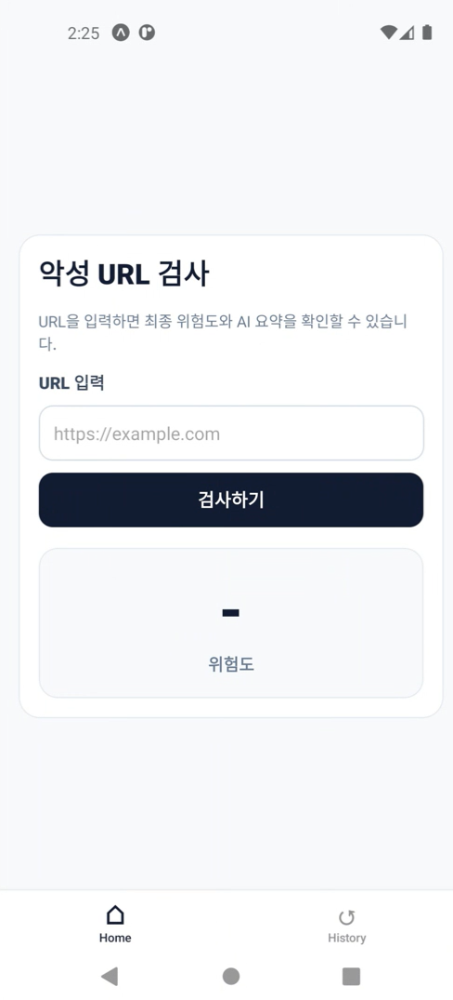
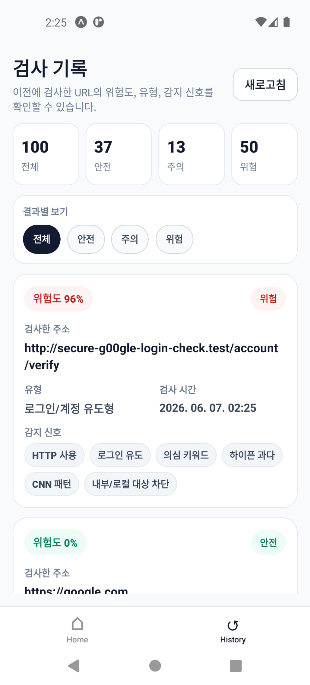

# PhishGuard - 악성 URL 탐지 앱

## 프로젝트 소개

CNN 모델과 URL 특징 기반 규칙 검사를 이용해 입력한 URL의 위험도를 분석하는 모바일 앱입니다. React Native로 앱을 구현하고, FastAPI와 PostgreSQL을 연결해 검사 결과를 저장하고 조회하도록 구성했습니다.

- 개발 형태: 개인 졸업작품
- 개발 기간: 2026년 1학기

## 프로젝트 목표

- URL 입력만으로 위험도를 확인할 수 있는 앱 구현
- CNN 모델과 규칙 기반 분석을 함께 사용
- 탐지 근거와 AI 요약 제공
- 검사 결과 저장 및 이력 조회

## 주요 기능

### URL 위험도 검사
- URL 문자열을 CNN 모델로 분석
- HTTP 사용, IP 주소, 의심 키워드, URL 구조 등 규칙 기반 검사
- 위험도(0~100%)와 탐지 근거 표시

### AI 요약 및 VirusTotal 조회
- 검사 결과에 대한 Gemini 기반 요약 제공
- VirusTotal API로 기존 URL 검사 결과 조회 (API 키 설정 시)

### 검사 기록
- URL, 위험도, 유형, 탐지 근거, 검사 시간 저장
- 이전 검사 결과 조회

## 기술 스택

**Frontend**
- React Native, Expo, TypeScript

**Backend**
- Python, FastAPI, SQLAlchemy

**Database / Infra**
- PostgreSQL, Docker Compose

**AI / External API**
- PyTorch (1D CNN), Gemini API, VirusTotal API

## 구현 사항

### URL 검사 화면



### 검사 기록 화면



### 위험도 계산

CNN 모델의 예측 결과를 최대 40점으로 변환하고, URL 구조 및 의심 특징을 검사하는 규칙 점수(최대 60점)를 합산합니다. HTTP 사용 여부, IP 주소, 로그인·계정 관련 키워드, URL 길이 등의 항목을 검사합니다.

표시되는 위험도는 URL 분석 점수이며, 실제 악성일 확률을 통계적으로 보장하는 값은 아닙니다.

### 서버 및 DB 연동

- Docker Compose로 PostgreSQL 실행 환경 구성
- FastAPI에서 검사 요청 처리 및 검사 기록 저장·조회 구현
- 앱과 서버를 HTTP API로 연결
- 연동 과정에서 로그 및 연결 상태 확인

```text
React Native (Expo)
        │
        ▼
      FastAPI
        ├── CNN 모델 (PyTorch)
        ├── URL 규칙 기반 검사
        ├── Gemini / VirusTotal API
        └── PostgreSQL (Docker)
```

**주요 API**
- `GET /health` : 서버 상태 확인
- `POST /scan` : URL 검사
- `GET /scans` : 검사 기록 조회

## CNN 모델

URL 전체 문자열을 문자 단위로 입력받는 1D CNN을 사용했습니다. 서로 다른 크기의 합성곱 필터로 문자열 패턴을 분석합니다.

모델 학습에는 공개 URL 데이터셋을 사용했으며, 원본 데이터는 저장소에 포함하지 않았습니다.

**검증 결과** (`artifacts/cnn_metrics_report.txt`, 학습 80% / 검증 20% 분할 기준)

| Accuracy | Precision | Recall | F1-score | AUC |
| --- | --- | --- | --- | --- |
| 99.83% | 99.99% | 99.61% | 99.80% | 99.91% |

